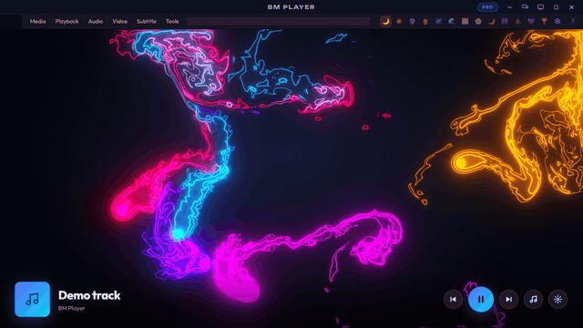
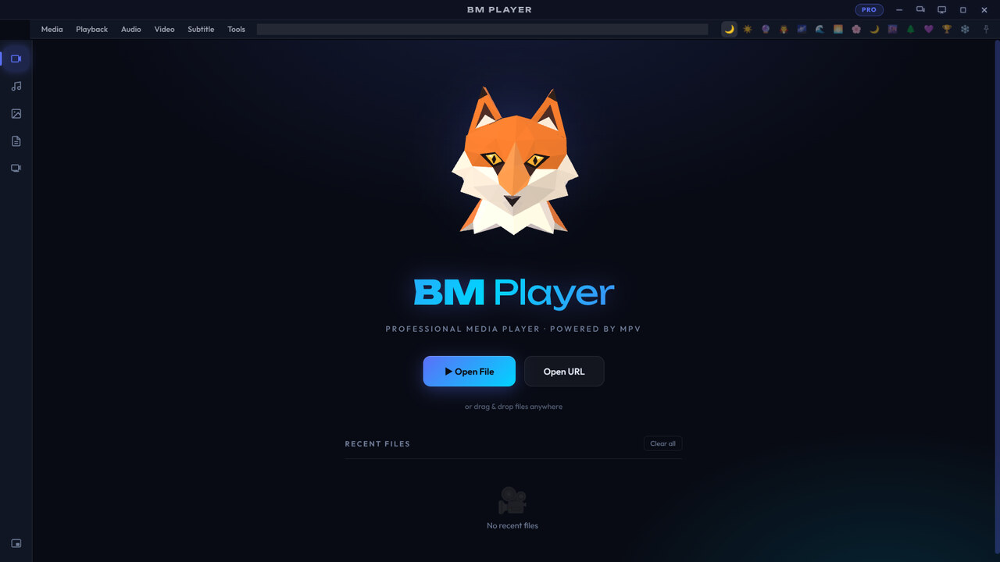
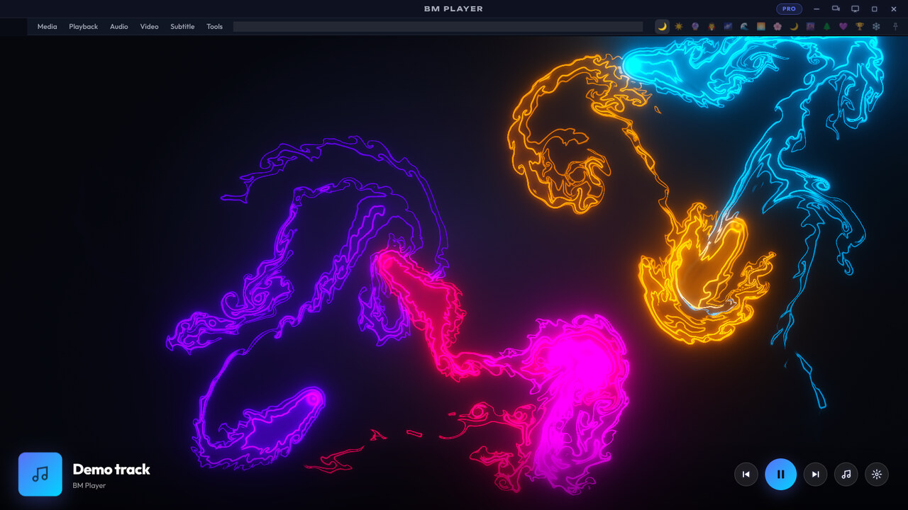
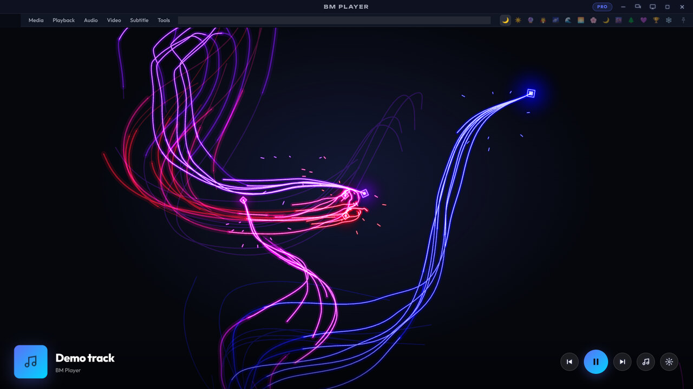
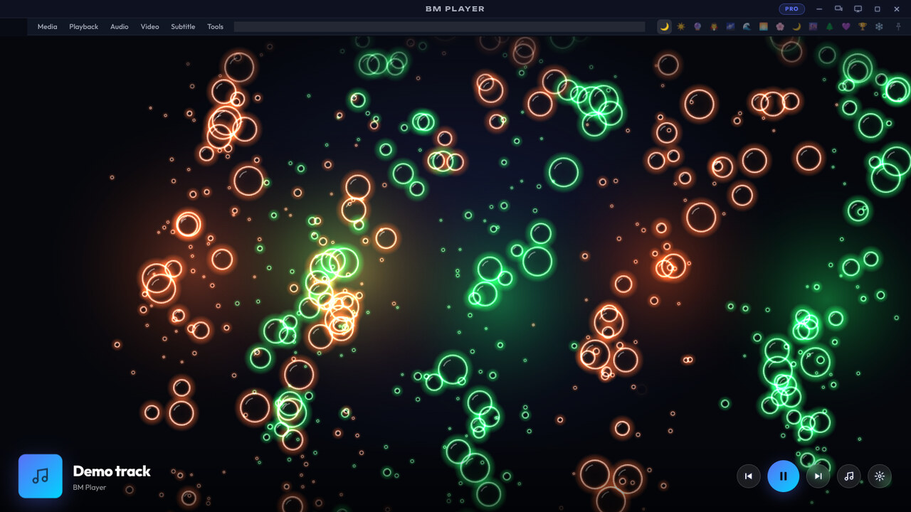
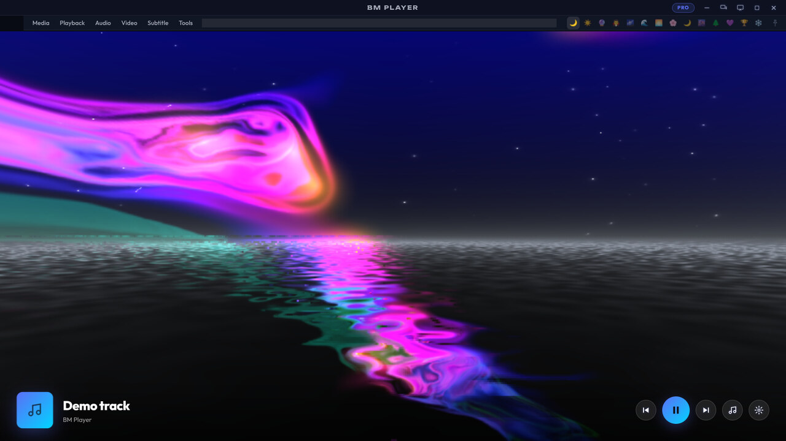
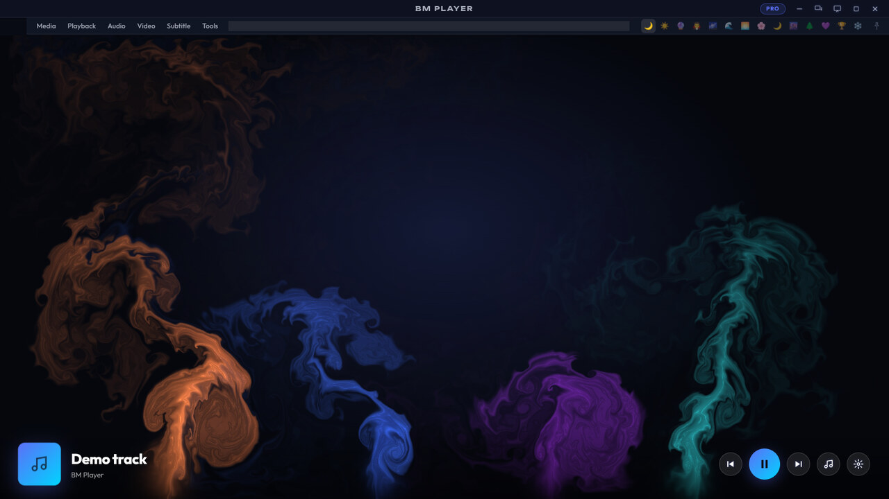
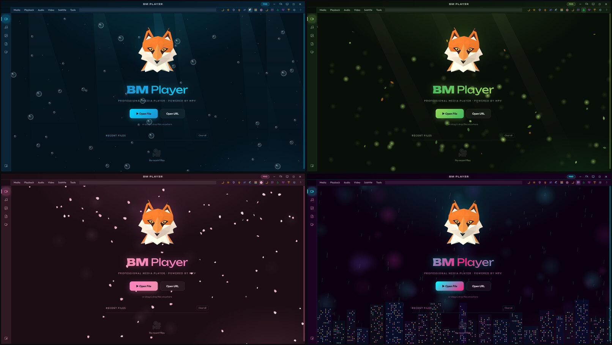

<p align="center">
  
</p>

# BM Player

A desktop media player built on [Electron](https://www.electronjs.org), with
[mpv](https://mpv.io) doing the playback. It plays video and music, and has an
image gallery, PDF tools, IPTV, 14 themes, a music visualiser in nine styles
and a plugin system. There is an Android app too (a preview): the phone's
music with the same visualiser, lyrics and themes, and its videos, played
by mpv as on the desktop.

[](https://github.com/BritMat/bm-player/actions/workflows/ci.yml)


## A look at it

<table>
  <tr>
    <td width="50%"><br><sub>The home screen</sub></td>
    <td width="50%"><br><sub>HD Flow: a fluid stirred by the music, in neon lines</sub></td>
  </tr>
  <tr>
    <td><br><sub>Neon: lanterns trailing lines of light</sub></td>
    <td><br><sub>Bubbles: they swell on the beat</sub></td>
  </tr>
  <tr>
    <td><br><sub>MilkDrop: the classic presets</sub></td>
    <td><br><sub>Smoke</sub></td>
  </tr>
  <tr>
    <td colspan="2"><br><sub>Four of the 14 themes: Ocean, Forest, Sakura and Cyberpunk, each with a scene of its own</sub></td>
  </tr>
</table>

Every picture here is the app itself, drawing to a test track.

## Download

Get the latest version from the **[Releases page](https://github.com/BritMat/bm-player/releases)**.
You only need one file.

**Windows (64-bit):** `BM-Player-Setup-<version>-x64.exe`. While it installs,
it downloads mpv from mpv's Windows builds on GitHub and checks it against the
build tested for that release, so it needs an internet connection. The
installer is not code-signed yet, so Windows SmartScreen may warn: choose
**More info**, then **Run anyway**.

**BM Player Lite (Windows, 64-bit):** `BM-Player-Lite-Setup-<version>-x64.exe`.
A lighter version for older or low-spec PCs, with simpler visuals, one window,
and the picture above a fixed control bar. It installs alongside the full
version.

**Linux (64-bit):** on Ubuntu or Debian, install
`BM-Player-<version>-amd64.deb` with `sudo apt install ./BM-Player-<version>-amd64.deb`,
which installs mpv too. On other distributions, install mpv from your package
manager, then make `BM-Player-<version>-x86_64.AppImage` executable and run it.

**macOS (experimental):** `BM-Player-<version>-arm64.dmg` for Apple Silicon,
`BM-Player-<version>-x64.dmg` for Intel. Install mpv first with
`brew install mpv`. The app is not notarized by Apple, so the first time,
open System Settings, Privacy & Security, and choose **Open Anyway**. Video
playback has not been tested on a Mac yet.

**Android (preview):** `BM-Player-<version>-android.apk` (about 30 MB), one
file for any phone or tablet with Android 7.0 or newer, 32-bit or 64-bit
(ARM, which is nearly every phone). Open it on the phone and allow your
browser or file manager to install apps when Android asks. Android may also
say the app is not from the Play Store: choose **Install anyway**. A newer
APK installs over the old one and keeps your settings. From 3.44.0 the app
updates itself: it looks here once a day, and when there is a newer APK,
**Update** on Home or in Settings downloads it, checks it and installs it,
with Android asking first.

The `latest.yml`, `latest-linux.yml` and `.blockmap` files on a release are
read by BM Player's built-in updater. You don't need to download them.

## What it does

- Plays video with mpv: subtitles, audio tracks, chapters, A-B loop,
  screenshots, playback speed, an equalizer, and resume where you left off.
- A picture of the film above the seek bar where the pointer is, and a drag
  on the seek bar moves the film as it goes.
- The picture's brightness, contrast, saturation, gamma and hue, zoom
  (Alt and + or -), moving a zoomed picture (Alt and the arrows), and
  filling the screen with the edges cut, in Video, Picture. The colours stay
  from film to film.
- Sound: night mode (quiet voices up, loud bangs down), mono or one ear
  only or the two swapped, and a boost to 150% or 200%, beside the
  equalizer. They work for films and for music alike.
- A second subtitle at the top of the picture, in Subtitle: two languages
  at once.
- A sleep timer (Playback, Sleep Timer): playing stops after 15 minutes to
  2 hours, or at the end of the film or song, with the sound fading out
  first.
- If mpv stops by itself, it is started again and the film carries on from
  where it was. A song that will not play (a broken or missing file) is
  passed over to the next one.
- Subtitles in any font on your computer, in the colour you choose, with a
  thin outline, a soft shadow, a see-through box or nothing round the
  letters.
- Turns the picture a quarter at a time (Ctrl+R, and Ctrl+Shift+R the other
  way) and mirrors it (Ctrl+M), for a phone video filmed on its side or a
  selfie camera. Each new file starts straight.
- Full screen on the whole screen, with F, F11 or a double-click on the
  picture. The controls and the pointer leave while the pointer is still.
- A music library laid out as a table: columns that sort when you press
  their heads, the artist under each title and the album beside it, and a
  head with the folder's covers, how many songs and how long they run, Play
  and Shuffle, with the visualizer playing behind it. Tag reading, playlists
  (including M3U), grouping by album, and its own playback speed (0.25x to
  3x, the pitch kept).
- Lyrics that follow the song, with the line being sung lit, in Now Playing
  and over the visualizer. They come from a .lrc, .srt or .vtt file beside
  the song, then the song's own tags, then [LRCLIB](https://lrclib.net)
  online. Only the artist, title, album and length are sent, each answer is
  kept so a song is looked up once, and looking online can be switched off.
  Where none are found you can search and choose, load a file (or drop one
  on the lyrics), and move the timing earlier or later.
- Lyrics in English letters as they sound: a Hindi, Malayalam, Tamil,
  Telugu, Kannada, Bengali, Punjabi, Gujarati, Odia, Korean, Russian,
  Ukrainian or Greek song's words written out for reading along, under the
  original lines or instead of them (Original, English letters, Both, above
  the lyrics).
- Subtitles from the web: Subtitle, Search Online opens opensubtitles.com
  with the film's name filled in, and the file you download loads with
  Load a subtitle file. OpenSubtitles closed the free search the app used
  in 2026.
- Optionally, lyrics from the captions of a YouTube video of the same song
  and length, through [yt-dlp](https://github.com/yt-dlp/yt-dlp), which is
  downloaded from its own releases the first time you turn this on (about
  18 MB) and checked against its published checksum. Off by default:
  YouTube's terms do not allow tools like it, and captions made by speech
  recognition are often wrong.
- An image gallery, PDF tools and IPTV.
- Picture-in-picture, in a small window that stays on top.
- 14 themes: four standard ones (Dark, Light, Dracula and Snow), Flow (a flowing
  fluid of light whose colours, intensity, size, swirl and trails you can set), and
  nine artistic ones, each with an animated scene of its own: ocean light and
  bubbles, forest fireflies, city lights in neon rain, falling cherry blossom, and
  more. And a 3D fox mascot.
- Keyboard shortcuts for nearly everything: press ? (or F1) in the app for the list.
- Pro or Lite, switched with one press of the button by the window controls.
- An audio visualiser that shows the music as it plays, its real frequencies
  and its beat, in nine styles, among them HD Flow (a fluid stirred by the
  music, and by your pointer, drawn as neon lines in the screen's own pixels),
  MilkDrop (61 of the classic presets through butterchurn, with a browser
  that shows a picture of each, favourites and a shuffle), Neon,
  Bubbles and Smoke, with the album art in Radial's middle, and settings for
  its style, colours, sensitivity and bars. The heavier styles step their
  quality down by themselves on a machine that cannot keep up. And subtitles
  in the font and colour you choose.
- Plugins: themes and scripts you add yourself (see below).
- Lite mode for weak hardware: lighter visuals, switched on automatically on
  low-spec machines and available as a setting in any build.
- A battery saver: on battery power the visualiser and the animated
  backgrounds draw at 30 frames a second instead of 72. The home screen's
  background rests when nothing plays and no one is there. A visualiser
  style or background that is put away gives its graphics memory back after
  half a minute or so (about 75 MB, measured, once the visualiser has been
  used), and builds it again when it is shown.
- The music's sound engine starts with the first song, not with the app, and
  rests ten seconds after the music pauses or stops. An app opened for a
  film no longer runs one (Chromium's sound process, 69 MB measured on
  Linux, waits until a song plays). While it plays a stream, mpv keeps at
  most 64 MB ahead and 32 MB behind in memory (its own defaults are 150 and
  50).
- Play on the home screen, the same as on the phone. The fox reacts where
  you touch it: boop its nose and it may sneeze, tap an ear and it flicks,
  stroke its head and it purrs, tickle its chin and it giggles, leave it
  alone and it yawns and dozes off. Press **Talk to the fox** and it repeats
  what you say in a high little voice (the sound stays on your computer).
  **Flow** turns the background into a fluid simulator to draw in, with its
  own colours, swirl, glow, neon lines and more, and **Fruit** is a fruit
  slicing game whose juice pours into the fluid. Nothing of it runs until
  you use it.
- The app's windows run in Chromium's sandbox, as web pages in a browser do,
  and stay on the app: a link or a stray dropped file can no longer replace
  the player. Measured on Linux, the sandbox costs no frames.
- Music tags are read with an up-to-date reader: the known ways a broken
  music file could freeze or close the app while its tags were read are
  fixed.
- Favourites on the home screen: the star on a recent file, on a song in the
  music library, or in the right-click menu for what is playing keeps it in
  a row of its own. Preferences, Home screen, shows or hides the Recent and
  Favourites rows, and so does the Hide button on each.
- In the music's full screen visualiser, the title bar and the menus fade
  with the controls after a few seconds, as they do over a film, and come
  back when the mouse moves.

## On Android

The Android app is a preview: it has been checked in a browser laid out as a
phone, and its own testing happens on real phones. What it does:

- Your music, from Android's own list of it: songs, albums, artists and
  folders, with search and sort. Voice notes, recordings and ringtones are
  left out unless you ask for every audio file. A long library stays quick:
  only the rows on screen are drawn.
- Plays on behind other apps and with the screen off, with the controls in
  the notification, on the lock screen, and on wired and Bluetooth
  headphones. It pauses when headphones are pulled out.
- Now Playing with the album art, or the visualiser behind the controls: all
  nine styles, MilkDrop with its preset browser, full screen if you like,
  and the line being sung over the picture.
- A home screen like the desktop's: the fox, **Browse** (a file, your music,
  videos or photos) and **Resume** (the video or the music you left), the
  things you opened last, your favourites (the star on a song, a video, a
  picture or a PDF), and the theme's background behind it all. Settings can
  take the Recent or the Favourites row off Home. Play
  with the fox (tap, stroke, tickle, hold, and **Talk**, and it repeats what
  you say), draw in **Flow**, a full screen fluid simulator with its own
  settings (tilt the phone to pour it), or play **Fruit**, slicing fruit
  with a swipe.
- Lyrics as on the desktop: a .lrc file beside the song (where Android lets
  the app read it), the words in the song's own tags (MP3, FLAC, Ogg, Opus
  and M4A), then LRCLIB, with search, loading a file, and the timing to
  move. And in English letters, as on the desktop.
- Up Next, shuffle and repeat, Play next and Add to queue, a ten-band
  equaliser, the speed with the pitch kept, and the queue kept for next time
  (Settings can turn that off). The X on the music bar, or Close in the
  notification, stops the music and puts the bar away.
- Videos, played by mpv built into the app: MKV, MP4, AVI and the rest, 4K
  and H.265, every audio track, and subtitles in the film or in a file
  beside it (.srt, .ass or .vtt), styled ones included. It uses the phone's
  hardware decoder where it can (HW, HW+ or SW, as you choose). The screen
  turns to suit the film. A file that still will not play can be opened in
  another app from the same screen, and Settings can switch to the phone's
  own web engine instead.
- Every video as a list or a grid, by folder, and the ones you left part
  way, with how far you got under each picture and NEW on the ones not
  opened yet. Each video carries on where you left it.
- The player's controls work as in MX Player: swipe up or down on the left
  for brightness and on the right for volume (past full, a boost to 150%),
  sideways to move through the video, pinch to zoom, hold for double speed,
  double tap to jump ten seconds. A lock, the picture's size (fit, fill,
  stretch, 100%, 16:9, 4:3), the previous and next video of the folder and
  playing on to the next, speed, repeating a part (A-B), a sleep timer, and
  the timing of the subtitles and the sound. The clock and the battery show
  with the controls.
- Photos: every picture on the phone, or by album, in a viewer with pinch
  and double tap zoom, swipes to the next one, turning, sharing and a
  slideshow.
- Delete and share. Press and hold a picture, a video or a song to choose
  several (taps add more or take them away, Select all takes the whole
  list), then share them to another app at once or delete them from the
  phone. Press and hold an album or a folder to delete it whole, or use the
  bin in the picture viewer, or a song's or a video's menu. From Android 11,
  Android itself asks before anything is deleted, and no permission is
  needed. On Android 10 and older, BM Player asks first. A folder left
  empty stays on the phone from Android 11 on (Android does not let an app
  remove a folder it did not make), but no longer shows in BM Player. What
  is deleted also leaves the favourites, Resume and the queue, and a song
  that was playing gives way to the next.
- A PDF reader (pdf.js): pages that scroll, zoom, find, contents, a dark page
  for night, and each document opens where you left it, password ones
  included.
- The 14 themes, a battery saver, and a log to share if something goes wrong
  (Settings, About).
- Updates from this page. Once a day (Settings can turn it off) the app
  asks GitHub for the list of releases, and shows a card on Home when one
  has a newer APK. Nothing downloads until you choose **Update**. The
  download is checked against GitHub's SHA-256 and against BM Player's own
  signing key before Android's installer gets it, and Android asks you
  before it installs. The first time, Android also asks you to allow BM
  Player to install apps. The check sends GitHub the app's version and
  nothing else.
- "Open with BM Player" for a song, a video, a picture or a PDF in a file
  manager or a chat.

## If something goes wrong

Open the menu, choose **Diagnostics…**, then **Copy report**. It lists
versions, where mpv was found, the graphics features available and recent
errors. Paste it into a
[new issue](https://github.com/BritMat/bm-player/issues) with what you were
doing when it happened.

## Building from source

You need [Node.js](https://nodejs.org) 22.12 or newer, and mpv on your `PATH`
(or its files in `vendor/mpv/`).

```bash
npm ci
npm start              # the app
npm run start:lite     # the one-window Lite layout
npm test               # the automated checks
```

To build installers, generate the icons first, then build for your platform:

```bash
npm run gen-icon
npm run build:win64        # or build:linux, build:mac, build:lite-win64
```

The installers land in `dist/`. GitHub Actions builds and publishes every
release from its version tag (`.github/workflows/ci.yml`).

The Android app builds with the plain Android SDK tools, without Gradle. On
Ubuntu or Debian:

```bash
sudo apt install android-sdk-build-tools dalvik-exchange openjdk-17-jdk-headless
npm run build:android      # dist/BM-Player-<version>-android.apk
npm run test:android       # its page in Chromium, laid out as a phone
```

mpv's libraries for the APK are mpv-android's own release builds: the build
downloads them from mpv-android's GitHub releases once, checks them against
the SHA-256 sums in `android/build-apk.mjs`, and adds them unchanged.

The first build makes a signing key in `android/keystore`. Keep it: Android
only installs an update signed with the same key as the app already there.
The release job signs with the key from the repository's secrets
(`BM_ANDROID_KEYSTORE`, the key file in base64, and
`BM_ANDROID_KEYSTORE_PASSWORD`). Without them, the APK built and checked
with the release is attached to it from the machine the checks ran on, with
the same sign-in Git uses to push.

## Plugins

Press **Folder** in the Plugins panel to open your plugins folder. BM Player
puts a README and two samples there: a theme and a script. Theme styles are
cleaned before use, and a script plugin you add stays switched off until you
approve it, and switches off again if its files change.

## License

MIT, see [LICENSE](LICENSE). The Unbounded and Outfit fonts in `src/fonts` are
bundled under the SIL Open Font License 1.1. PDFs are read with Mozilla's
[pdf.js](https://github.com/mozilla/pdf.js), under the Apache License 2.0
([src/vendor/pdfjs-LICENSE.txt](src/vendor/pdfjs-LICENSE.txt)). mpv is a separate project with its own license,
downloaded from its Windows builds on GitHub or installed from your system's
package manager.

The Android APK also carries mpv and FFmpeg, as built by
[mpv-android](https://github.com/mpv-android/mpv-android) (release
2026-09-17). Together they are under the GNU GPL version 3, so the APK as a
whole is passed on under the GPL too, while BM Player's own code stays MIT.
[android/licenses/NOTICE.txt](android/licenses/NOTICE.txt) lists every
library in them with its licence and where the source code is, and the app
shows the same in Settings, About, Licences.

## Credits

The MilkDrop style uses [butterchurn](https://github.com/jberg/butterchurn) and
[butterchurn-presets](https://github.com/jberg/butterchurn-presets), both MIT
licensed (src/vendor/milkdrop/LICENSE.txt).

Online lyrics come from [LRCLIB](https://lrclib.net), a free and open
collection of lyrics. YouTube captions, when turned on, are fetched with
[yt-dlp](https://github.com/yt-dlp/yt-dlp) (Unlicense), downloaded at that
point and not part of BM Player.

The fluid (behind the home screen, and in the Smoke and HD Flow styles) follows
the method of [WebGL Fluid Simulation](https://github.com/PavelDoGreat/WebGL-Fluid-Simulation)
by Pavel Dobryakov, MIT licensed (src/vendor/webgl-fluid/LICENSE.txt).
